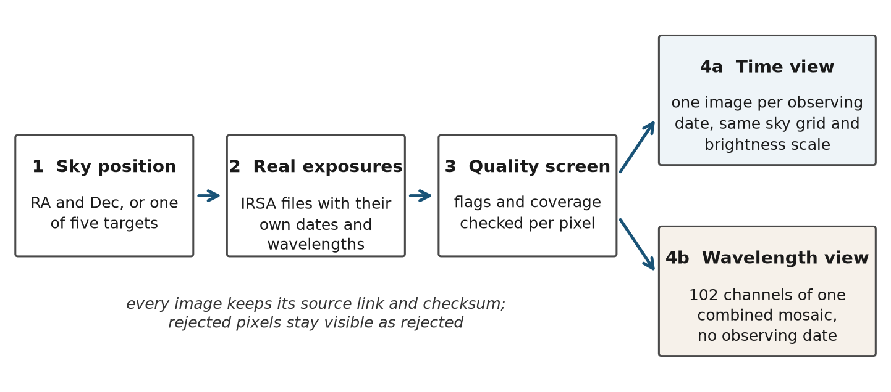
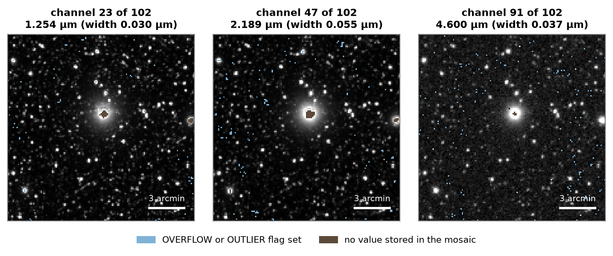
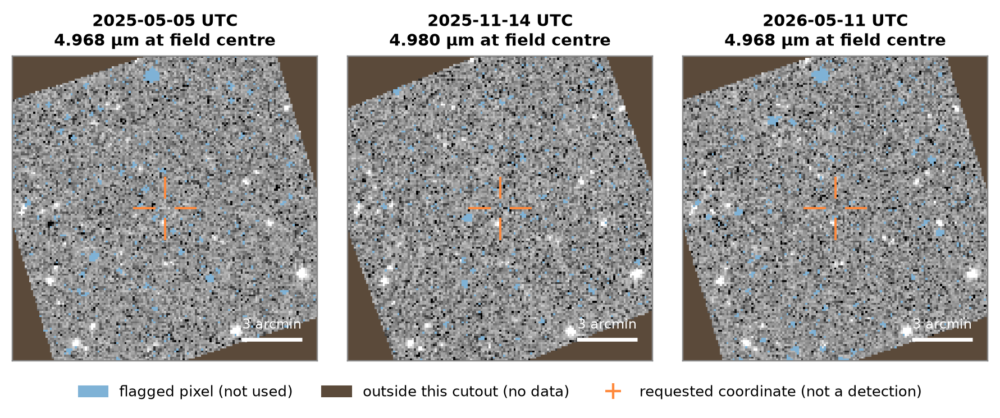
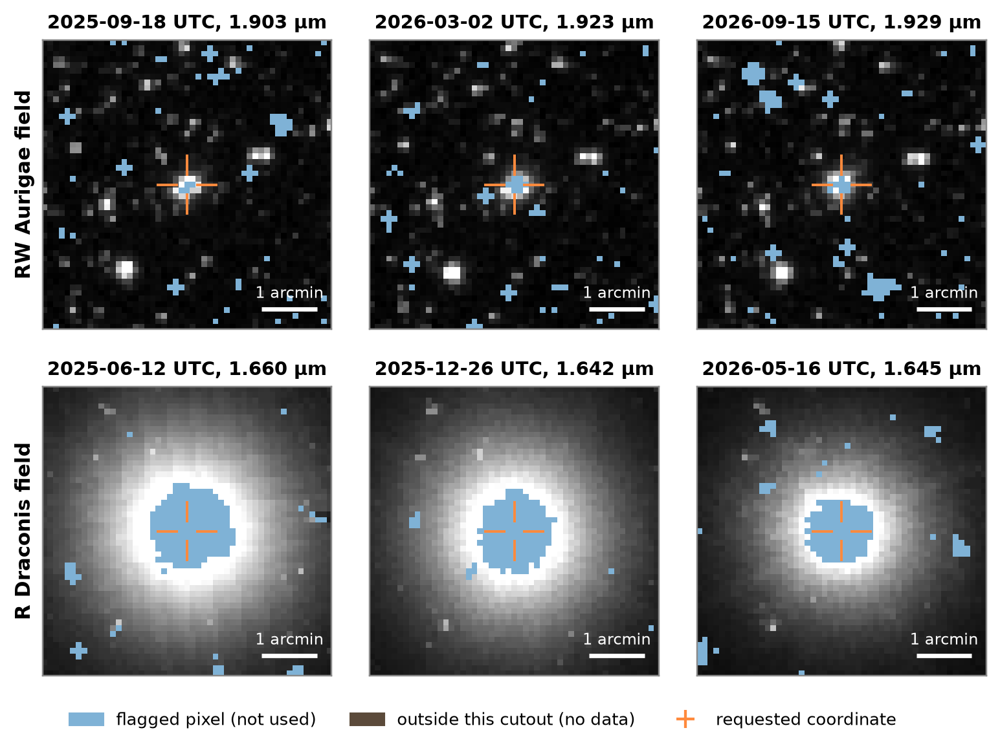
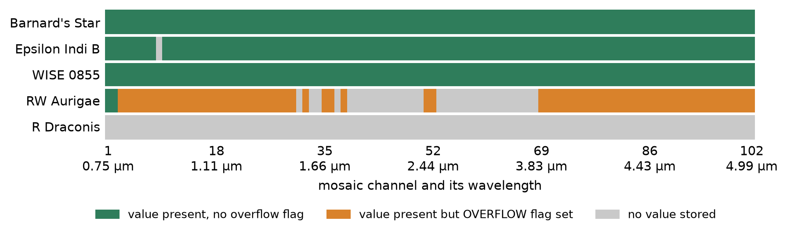
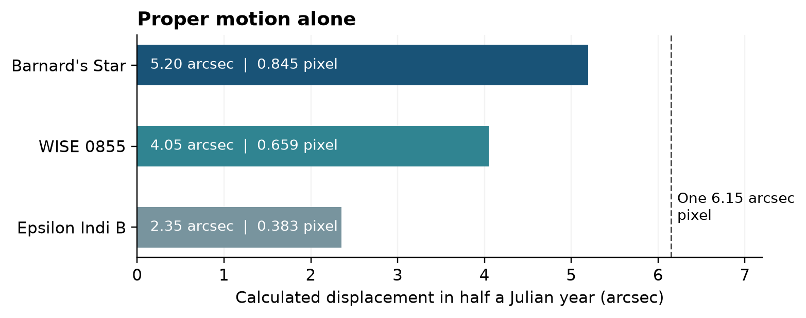

# Seeing real change in SPHEREx sky images

A date-true image comparison tool, tested on five target fields with real archive data

Planet X and SPHEREx project | Revised project report | 15 November 2026

## Summary

**What we built.** SPHEREx Voyage is a web tool that lets anyone choose a sky position and see how NASA's SPHEREx telescope recorded that patch of sky on different dates. It is aimed at students, citizen scientists and anyone curious about objects that move or change brightness. It uses real SPHEREx images from the NASA/IPAC Infrared Science Archive (IRSA), keeps every image tied to its true observing date and wavelength, and marks pixels the archive itself flags as unreliable.

**Why it is useful.** Two SPHEREx images of the same field can look different for reasons unrelated to the sky: a different wavelength, a saturated detector pixel or a clipped image. A viewer that hides those reasons invites false discoveries. Ours shows them.

**What this report demonstrates.** We verified a collection of 20 original SPHEREx files for the five challenge targets: five 102-channel wavelength mosaics and 15 dated image cutouts, three per target. Applying one fixed quality rule to the pixel at each requested coordinate accepted 7 of the 15 dated images and rejected 8. Every image of the R Draconis and RW Aurigae fields was rejected at its centre because of overflow and bloom flags. Read without the flags, the RW Aurigae centre pixel would appear to brighten by about 90 percent between two dates. That apparent change is not a measurement, and the tool is designed to say so.

**What it does not show.** This report does not identify the five objects in the images, measure any motion or brightness change, or claim a discovery.

**Keywords:** SPHEREx; time-domain astronomy; data quality flags; proper motion; citizen science; reproducibility.

## 1 The project in brief

### 1.1 The problem

The Planet X and SPHEREx challenge asks for a public tool that shows SPHEREx images of a chosen patch of sky changing over time. SPHEREx maps the whole sky repeatedly in 102 infrared colours between 0.75 and 5 micrometres [R18, R07]. Objects that move, such as nearby stars and brown dwarfs, or that vary in brightness, such as young and pulsating stars, should look different from one pass to the next.

The difficulty is that most differences between two SPHEREx images are not astronomical. Each exposure records each point of sky at a wavelength that depends on where the point falls on the detector [R07]. Bright stars overflow the detector. Cutouts near a detector edge are clipped. A public tool therefore has to answer a harder question than "do these pictures differ?". It has to help the user judge whether a difference could be real.

### 1.2 Our solution and how it operates

Figure 1. How the tool operates. A sky position leads to real archive exposures, each with its own date and wavelength. A quality screen checks the archive's flags before anything is compared. The user then explores either the time view or the wavelength view. The two are kept apart because a wavelength channel is not an observing date.

The tool follows four steps. First, the user picks one of five preset targets or enters right ascension and declination. Second, the tool uses only exposures that exist in the archive, with the dates the archive records. Third, each pixel is checked against the archive's quality flags and the edge of the cutout. Fourth, the user explores the result in one of two views. The **time view** steps through dated images on a common sky grid and brightness scale, with each date and wavelength printed beside the image. The **wavelength view** steps through the 102 channels of a combined mosaic, which has no single observing date.

### 1.3 Who it helps

A student can see what a real survey image looks like, including its gaps. A citizen scientist can check whether an apparent change survives the quality flags before reporting it. A teacher can use the five targets as worked examples of motion and variability. A developer can reuse the checks, because each one is written down with its inputs.

### 1.4 What exists today

<!-- COLS .52 .2 .28 -->
| Part | Status | Where |
| --- | --- | --- |
| 3D sky map with the five targets at their real coordinates | Built | Web prototype |
| Player that steps through dated SPHEREx cutouts on a timeline with true gaps | Built | Web prototype |
| Difference view with a warning when wavelengths differ, and a mask-aware stack | Built | Web prototype |
| "Project +1 year" marker from catalogue motion, labelled as a projection | Built | Web prototype |
| Link that opens a target or pins a coordinate | Built | Web prototype |
| Verification of the 20-file image archive | Done | This report, section 2 |
| Quality screen with decoded flag names | Demonstrated offline | This report, section 4 |
| Wavelength view of the 102-channel mosaics | Demonstrated offline | This report, section 3 |
| Live archive query for any coordinate, field-size choice, catalogue overlays, spectra | Not built | Section 7 |

Table 1. Status of each part. "Built" means it runs in the SPHEREx Voyage web prototype. "Demonstrated offline" means the result in this report was produced by the accompanying scripts and is not yet a feature of the website.

## 2 The data

### 2.1 Two SPHEREx products with different jobs

A **spectral image** is one exposure from one detector. It has an observing time, and its wavelength changes smoothly across the image [R07]. Spectral images are the only product in this report that can show change over time. A **mosaic cube** is assembled by the IRSA mosaic tool from many spectral images. It has one plane per spectral channel, and each pixel can combine several exposures [R21]. The mosaics used here carry no observing date in their headers, so they show how a field looks at different wavelengths and nothing about when.

### 2.2 The image archive we verified

The project's image archive (PlanetX_Image_Set, about 106 MB) was retrieved from IRSA before this revision. We opened every FITS file and compared it with the archive's own records. The archive contains five target fields, five mosaic cubes and 15 dated spectral-image cutouts, three per target. All 20 files match their recorded SHA-256 checksums, and all 15 observing dates in the FITS headers match the archive's index.

Each mosaic is 147 by 147 pixels at 6.15 arcseconds per pixel, about 15.1 arcminutes on a side, with 102 channels from 0.753 to 4.988 micrometres drawn from all six detectors. Its extensions are IMAGE in MJy/sr, NHITS (how many input pixels contributed) and FLAGS, which records only OVERFLOW, OUTLIER and SOURCE. Across the five cubes, the median number of input pixels contributing to a channel ranges from 2 to 8. Each dated cutout comes from a single exposure of about 114 seconds and contains IMAGE, FLAGS, VARIANCE, ZODI, EPSF and WCS-WAVE extensions, with times on the UTC scale. Eleven cutouts are from Data Release 1 and four from Quick Release 3, which the archive describes as uniformly processed with DR1 [R16].

<!-- COLS .15 .25 .17 .23 .2 -->
| Target field and centre (RA, Dec in degrees) | Dated cutouts: date (UTC) and wavelength at field centre | Mosaic | Main limitation | What the data support |
| --- | --- | --- | --- | --- |
| **Barnard's Star** 269.4500, +4.7500 | 2025-08-15, 2.407 µm; 2026-03-21, 2.415 µm; 2026-09-20, 2.420 µm. Detector 3 | 102 channels, 99.0 to 99.8% of pixels usable per channel | Cutouts clipped at a detector edge: 13, 31 and 44% of the field has no data. A low-efficiency (DICHROIC) zone covers the centre on two dates | Field coverage on three dates at closely matched wavelengths |
| **Epsilon Indi B** 331.0441, -56.7828 | 2025-06-10, 4.657 µm; 2026-05-04, 4.690 µm; 2026-09-25, 4.662 µm. Detector 6 | 102 channels, 90.3 to 99.6% usable | Wavelengths differ by 0.033 µm, close to one channel width (0.037 µm) | Field coverage on three dates; centre pixel passes the screen on all three |
| **WISE 0855** 133.7951, -7.2451 | 2025-05-05, 4.968 µm; 2025-11-14, 4.980 µm; 2026-05-11, 4.968 µm. Detector 6 | 102 channels, 92.3 to 97.2% usable | Images are dominated by noise; no source is evident at the requested coordinate | Field coverage on three dates at the best-matched wavelengths in the archive |
| **RW Aurigae** 76.9565, +30.4014 | 2025-09-18, 1.903 µm; 2026-03-02, 1.923 µm; 2026-09-15, 1.929 µm. Detector 3 | 102 channels, 97.7 to 99.3% usable, but the centre is usable in only 2 | Centre pixel flagged on all three dates (overflow, onboard error, bloom) | A clear example of data that must be rejected at the centre |
| **R Draconis** 248.1676, +66.7550 | 2025-06-12, 1.660 µm; 2025-12-26, 1.642 µm; 2026-05-16, 1.645 µm. Detector 3 | 102 channels, 95.6 to 99.8% usable, but the centre has no value in any channel | Centre and its 5 by 5 neighbourhood flagged on all three dates | The strongest rejection case: no usable central pixel anywhere |

Table 2. The five target fields in the verified archive. Wavelengths are evaluated at the fixed field centre from each cutout's wavelength lookup table. They are display approximations, and they are not the wavelength at a moving target's true position. "Usable" means a value is stored and neither OVERFLOW nor OUTLIER is set. The field centres are the requested coordinates. Whether each named object sits at its field centre on these dates has not been checked.

### 2.3 Other observations mentioned in this report

Two further datasets appear below and are kept separate from the archive. The first version of this report examined **two other R Draconis cutouts**, observation IDs 2025W20_2D_0243_1 (2025-05-16) and 2026W19_1A_0842_1 (2026-05-06), both near 1.655 µm. They are different exposures from the three R Draconis dates in Table 2, and we cite their result only in section 4.3. The web prototype's player uses **its own set of IRSA cutouts**, prepared earlier. Those frames are not analysed here, and no result in this report depends on them.

## 3 Two views that must stay separate

### 3.1 Wavelength view

Figure 2. Wavelength view: three of the 102 channels of the Barnard's Star field mosaic, 15.1 arcminutes on a side, north up and east left. Each panel has its own brightness scale (1st to 99.5th percentile, asinh), so brightness cannot be compared between panels. Pixels with no stored value, including the core of the bright star near the centre, are left unfilled. The mosaic has no observing date. Source: IRSA mosaic tool, SPHEREx data [R21].

Figure 2 shows what the wavelength view can and cannot do. The same star field is recognisable in all three channels, and the number of visible stars drops toward 4.6 micrometres. This is a comparison across colour. It says nothing about change over time, because every plane of the cube can mix exposures from different dates. A tool that animated these 102 planes as a "time-lapse" would be showing something that never happened.

### 3.2 Time view

Figure 3. Time view: the WISE 0855 field on three real observing dates, on the same 15.1 arcminute sky grid as the mosaic, north up and east left. All three panels share one brightness scale. Field-centre wavelengths agree to 0.012 µm, but they are not identical. Blue pixels are flagged and unused. Brown areas lie outside the cutout and hold no data. The orange marks show the requested coordinate. They do not mark a detected object. Source: SPHEREx spectral images, DR1, via IRSA [R16].

For each dated cutout we subtracted the zodiacal-light model supplied in the file, placed the pixels on the mosaic's sky grid by nearest-neighbour sampling, and subtracted the median of the accepted pixels so that a uniform background offset is not mistaken for change. One brightness scale is shared by all three dates of a target (1st to 99.5th percentile of the pooled accepted pixels, asinh). Nearest-neighbour placement is a display choice. It is not suitable for measuring positions or brightness.

Figure 3 uses the WISE 0855 field because its three dates have the most closely matched wavelengths in the archive. The same faint stars reappear on all three dates, which shows that the common grid works. Nothing is evident at the requested coordinate, and section 4 explains why that absence is reported as it is.

## 4 Demonstration: a quality screen for the requested position

### 4.1 Inputs and rule

The question a user most often asks is "what happened at my coordinate?". The demonstration tests whether the pixel at that coordinate can be trusted at all. The inputs are the FLAGS extension of each of the 15 dated cutouts and the 102-channel FLAGS and IMAGE planes of each mosaic. Flag names are read from the FITS headers and agree with the archive's flag documentation [R09].

The rule is fixed in advance and is the same one used in the first version of this report. A pixel is **accepted** only if no flag is set other than SOURCE (the pixel lies on a catalogued source) and FULLSAMPLE (extra sampling history exists), both of which are informational. Any other flag **rejects** it. The rule is deliberately strict. It is our display policy, and the archive does not prescribe it.

### 4.2 Result on the dated images

<!-- COLS .17 .16 .42 .25 -->
| Target field | Dates accepted at centre | Flags at the centre pixel | Rejected pixels in the central 5 by 5 block |
| --- | --- | --- | --- |
| Barnard's Star | 1 of 3 | SOURCE; then DICHROIC on the two later dates | 0, 25, 25 |
| Epsilon Indi B | 3 of 3 | SOURCE only | 0, 0, 4 |
| WISE 0855 | 3 of 3 | SOURCE only | 0, 2, 0 |
| RW Aurigae | 0 of 3 | TRANSIENT, SUR_ERROR, BLOOM; then OVERFLOW, BLOOM | 4, 8, 8 |
| R Draconis | 0 of 3 | OVERFLOW, SUR_ERROR, BLOOM on every date | 25, 25, 25 |

Table 3. The quality screen applied to the 15 dated cutouts. Seven central pixels are accepted and eight are rejected. Counts in the last column are listed in date order. Appendix A gives the full record for each exposure.

Figure 4 shows the two fields where every date is rejected. In the R Draconis field the rejected region is about a dozen pixels across on every date, and the IMAGE extension stores no value at the centre. In the RW Aurigae field the rejected region is only a few pixels wide, but it sits exactly on the requested coordinate.

Figure 4. The central 5.2 arcminutes of the RW Aurigae field (top) and the R Draconis field (bottom) on their three observing dates, north up and east left. Each row shares one brightness scale. Blue pixels are rejected by the rule in section 4.1 and are not filled in. In both fields the requested coordinate falls on rejected pixels on every date. Wavelengths at the field centre differ by up to 0.026 µm (top) and 0.018 µm (bottom). Source: SPHEREx spectral images, DR1 and QR3, via IRSA [R16].

### 4.3 The same result in the mosaics and in the earlier cutouts

Figure 5. The centre pixel of each mosaic, channel by channel. Barnard's Star and WISE 0855 have a usable value in all 102 channels and Epsilon Indi B in 101. RW Aurigae has a usable value in only 2 channels: 68 carry the OVERFLOW flag and 32 store no value. R Draconis stores no value in any channel. Source: IRSA mosaic tool, SPHEREx data [R21].

The mosaics give the same answer by an independent route (Figure 5). They were assembled by the archive from many exposures, and the centre of the R Draconis field holds no value in any of the 102 channels. The two R Draconis cutouts examined in the first version of this report (section 2.3) also had OVERFLOW, SUR_ERROR and BLOOM set at the centre on both dates. Across both datasets, all five single R Draconis exposures we have opened are rejected at the centre.

### 4.4 What the result means

The flags are consistent with a very bright source at the requested coordinate in both fields, which is what one expects for these two stars. We have not independently confirmed which source it is.

The practical point is what happens if the flags are ignored. The stored IMAGE value at the RW Aurigae centre pixel is 235, 197 and 373 MJy/sr on the three dates. A viewer that plotted those numbers would show a brightness that falls by 16 percent and then rises by 90 percent. RW Aurigae is known for real dimming events [R02], so such a curve would look convincing. It would also be wrong to report, for three reasons that the data themselves supply: the pixel is flagged for overflow or onboard error on every date, the three exposures sample slightly different wavelengths (1.903, 1.923 and 1.929 µm), and one pixel is not a measurement of a star's total light. The quality screen turns a misleading curve into a clear statement: there is no reliable central measurement of this field in these exposures.

Passing the screen has a limit too. The WISE 0855 centre pixel is accepted on all three dates, with values of 0.18, 0.05 and -0.08 MJy/sr after zodiacal subtraction and a per-pixel uncertainty near 0.07 MJy/sr. Those values scatter around zero. An accepted pixel means the data are usable. It does not mean an object was detected.

### 4.5 Limits of the demonstration

The screen was applied at the fixed field centre, not at a position predicted for each object on each date. It tests data quality and makes no statement about identification. The rule is strict: the two Barnard's Star rejections come from a low-efficiency detector zone, which a more lenient policy might accept with a warning. We have no ground-truth comparison, so we do not claim that the screen improves accuracy by any stated amount. The supported claim is narrower: on these 15 exposures, the screen separates central pixels that the archive marks as compromised from those it does not, and in two of the five fields that changes what a user should conclude.

## 5 How the science shaped the design

Each design rule in the tool follows from a number. This section gives the numbers that matter most. Longer derivations are in Appendix B.

### 5.1 Motion is small compared with a pixel

For constant proper motion of size μ, the shift after a time interval and its size in pixels are

$$ (1) \Delta\theta\simeq\mu\,\Delta t,\qquad \Delta p=\frac{\Delta\theta}{s_{\rm pix}} $$

where the pixel size s is 6.15 arcseconds. Using published proper motions [R01, R03, R04], Figure 6 shows the half-year shifts.

Figure 6. Calculated shift over half a year from published proper motion alone, ignoring parallax and orbital motion. Sources: [R01] Table 1, [R03] Table 4 and [R04]. These are calculations from the literature. They are not measurements from SPHEREx images.

<!-- COLS .2 .2 .22 .19 .19 -->
| Target | Published motion (arcsec per year) | Archive baseline, first to last date (days) | Expected shift (arcsec) | Expected shift (pixels) |
| --- | --- | --- | --- | --- |
| Barnard's Star | 10.39 [R01] | 400.3 | 11.4 | 1.85 |
| WISE 0855 | 8.1 [R04] | 370.4 | 8.2 | 1.34 |
| Epsilon Indi B | 4.71 [R03] | 472.1 | 6.1 | 0.99 |

Table 4. Expected shifts over the archive's actual date ranges, from Equation 1. These are literature expectations and were not measured in the images.

**Design consequence.** The expected shifts are one to two pixels at most, comparable to the width of a star image, 7 to 9 arcseconds according to the cutout headers. Motion of this size cannot be judged by eye from three frames. The prototype therefore never draws a moved object. Its "Project +1 year" control draws a labelled marker from catalogue motion and leaves the image pixels untouched. Table 4 also shows why a fixed coordinate is not enough: over the archive baseline Barnard's Star should move by nearly two pixels, so a correct identification needs the position propagated to each date. The older claim of a planet around Barnard's Star, since reinterpreted as stellar activity [R10], concerns a far smaller wobble and is outside what this tool addresses.

### 5.2 Brightness depends on wavelength

A ratio of two fluxes measured in the same band corresponds to a magnitude difference

$$ (2) \Delta m=-2.5\log_{10}\left(\frac{F_2}{F_1}\right) $$

For RW Aurigae A, published spectra from a dim and a bright state differ by a factor of 11.8 in the blue B band and by at most 2.1 in the infrared K band [R02]. Equation 2 turns these into 2.68 and 0.81 magnitudes. The same event is more than three times larger in magnitudes at one wavelength than at another.

**Design consequence.** Two images at different wavelengths cannot be read as one light curve. The tool prints the wavelength of every dated frame, and the difference view warns when the two frames differ in wavelength. This is also why Table 2 lists the wavelength of each cutout and why section 4.4 treats the 0.026 µm spread at RW Aurigae as a reason for caution.

### 5.3 A few visits cannot establish a period

R Draconis is a pulsating star with a period near 246 days [R05]. A historical visual study found a mean interval of 245.3 days between maxima, with cycle-to-cycle scatter of about 7 days [R06], and radio and visual maxima do not coincide [R17]. The number of cycles between two dates separated by an interval is

$$ (3) \Delta\phi=\frac{\Delta t}{P} $$

The archive's three R Draconis dates are separated by 196.6 and 141.1 days. With a period P of 246 days these are 0.80 and 0.57 of a cycle.

**Design consequence.** Three samples spread over 1.4 cycles cannot fix a period, an amplitude or a time of maximum, even if every pixel were usable. The timeline therefore shows real gaps between dates, and the tool does not fit or display a period.

### 5.4 From displayed units to a brightness

SPHEREx images are in surface-brightness units, MJy/sr. One 6.15-arcsecond pixel covers 8.89 x 10^-10 steradian, so 1 MJy/sr in one pixel is about 0.89 mJy. Turning an image into a star's brightness needs a sum over an aperture, a background estimate and an uncertainty (Appendix B). None of that has been validated here, which is why the tool labels its images as quick-look displays and reports no fluxes.

## 6 What is established and what is not

<!-- COLS .27 .41 .32 -->
| Kind of statement | Examples in this report | Status |
| --- | --- | --- |
| Published findings | Proper motions, RW Aurigae flux ratios, R Draconis period | Taken from the cited papers, unchanged |
| Calculations from published values | Figure 6, Table 4, Equations 2 and 3 | Arithmetic done here; these are expectations |
| Demonstrated with real SPHEREx files | Archive verification, Figures 2 to 5, Tables 2 and 3 | Reproducible from the accompanying scripts |
| Built in the prototype | Rows marked "Built" in Table 1 | Runs today; not formally tested with users |
| Future work | Identification, motion and brightness measurement, live queries | Not done |

Table 5. The five kinds of statement in this report and how far each can be relied on.

The main limitation is identification. The archive establishes that SPHEREx observed the five requested fields on separate dates. It does not establish which pixels belong to each named object. Until each object's position is propagated to each observing date and matched to a source, any statement about motion or variability would be unsupported, so we make none.

Three smaller limitations follow from the data. Three dates per target is a thin time series. The wavelengths of the dated frames are matched only approximately and are evaluated at the field centre. The display processing uses nearest-neighbour placement and a simple median background, which suit inspection and nothing more.

## 7 Conclusion

SPHEREx Voyage shows real SPHEREx observations of a chosen field on their true dates and keeps the reasons for doubt in view. Its value is already visible in the data examined here. With 20 verified archive files for the five challenge targets, a single quality rule showed that the requested position is unusable in every exposure of two fields, and that one of them would otherwise produce a convincing but invalid brightness change. A viewer without this screen would mislead its users on two of the five benchmark targets. A viewer with it tells them plainly that no reliable central measurement exists.

The main limitation is that the objects have not yet been identified in the images, so the tool currently supports inspection and quality checking, and stops short of measurement.

The next step is specific: compute each target's expected position on each of the 15 observing dates from published motion and parallax, mark it in the time view as a prediction, and apply the same quality screen at that position. This would turn the screen from a check on a coordinate into a check on an object, and it is the first requirement for any later measurement.

## Data availability and acknowledgements

The folder that accompanies this report contains the scripts that verify the archive and draw Figures 1 to 5, the verification record for all 20 files (data/archive_verification.json), the display limits used for the shared brightness scales, and the original first version of the report. The image archive itself, PlanetX_Image_Set, is distributed separately because of its size. The reference records, the two earlier R Draconis cutouts and the scripts for Figure 6 remain in the first version's Paper folder.

This work uses SPHEREx data products made available through the NASA/IPAC Infrared Science Archive. SPHEREx is jointly developed by the Jet Propulsion Laboratory and the California Institute of Technology with funding from the National Aeronautics and Space Administration. The DR1 spectral-image dataset is cited as DOI 10.26131/IRSA678 [R16]. Published measurements remain credited to their authors. No AI-generated astronomical imagery is used, and no NASA endorsement is implied.

<!-- PAGE -->
## Appendix A Record of the 15 dated exposures

<!-- COLS .13 .14 .17 .1 .13 .1 .23 -->
| Field | Date (UTC) | Observation ID | Release, detector | Wavelength, width (µm) | Field with accepted data | Centre pixel |
| --- | --- | --- | --- | --- | --- | --- |
| Barnard's Star | 2025-08-15 20:49 | 2025W33_2C_0321_3 | DR1, 3 | 2.4072, 0.0558 | 48% | Accepted |
| Barnard's Star | 2026-03-21 06:43 | 2026W12_2A_0324_2 | DR1, 3 | 2.4151, 0.0488 | 33% | Rejected: DICHROIC |
| Barnard's Star | 2026-09-20 04:27 | 2026W38_2A_0562_1 | QR3, 3 | 2.4199, 0.0437 | 22% | Rejected: DICHROIC |
| Epsilon Indi B | 2025-06-10 04:33 | 2025W24_1A_0245_4 | DR1, 6 | 4.6565, 0.0371 | 82% | Accepted |
| Epsilon Indi B | 2026-05-04 02:48 | 2026W19_1A_0041_1 | DR1, 6 | 4.6899, 0.0374 | 82% | Accepted |
| Epsilon Indi B | 2026-09-25 06:47 | 2026W39_2A_0169_2 | QR3, 6 | 4.6617, 0.0368 | 71% | Accepted |
| WISE 0855 | 2025-05-05 16:48 | 2025W19_1B_0116_1 | DR1, 6 | 4.9684, 0.0372 | 85% | Accepted |
| WISE 0855 | 2025-11-14 21:54 | 2025W46_2A_0289_1 | DR1, 6 | 4.9800, 0.0375 | 84% | Accepted |
| WISE 0855 | 2026-05-11 02:18 | 2026W20_1A_0033_1 | DR1, 6 | 4.9684, 0.0372 | 85% | Accepted |
| RW Aurigae | 2025-09-18 14:22 | 2025W38_2C_0023_1 | DR1, 3 | 1.9030, 0.0465 | 93% | Rejected: TRANSIENT, SUR_ERROR, BLOOM |
| RW Aurigae | 2026-03-02 13:31 | 2026W10_1A_0120_1 | DR1, 3 | 1.9228, 0.0470 | 95% | Rejected: TRANSIENT, SUR_ERROR, BLOOM |
| RW Aurigae | 2026-09-15 21:09 | 2026W38_1A_0359_4 | QR3, 3 | 1.9291, 0.0470 | 93% | Rejected: OVERFLOW, BLOOM |
| R Draconis | 2025-06-12 15:50 | 2025W24_2D_0033_1 | DR1, 3 | 1.6597, 0.0397 | 88% | Rejected: OVERFLOW, SUR_ERROR, BLOOM |
| R Draconis | 2025-12-26 05:13 | 2025W52_2A_0161_2 | DR1, 3 | 1.6419, 0.0393 | 82% | Rejected: OVERFLOW, SUR_ERROR, BLOOM |
| R Draconis | 2026-05-16 08:43 | 2026W20_2A_0294_2 | QR3, 3 | 1.6454, 0.0393 | 77% | Rejected: OVERFLOW, SUR_ERROR, BLOOM |

Table A1. Values read from the FITS headers and extensions of each cutout. "Field with accepted data" is the share of the 15.1 arcminute field whose pixels lie inside the cutout and pass the rule in section 4.1. The remainder is either flagged or outside the cutout. Every centre pixel also carries the informational SOURCE flag. Source links and checksums for each file are in the archive's Dated_Frame_Index.csv.

## Appendix B Background for future measurements

The main text uses only Equations 1 to 3. The relations below are not applied to data in this report. They are kept because a later version of the tool will need them, and each is paired with the condition under which it holds.

**Position over time.** A fuller model than Equation 1 adds annual parallax to proper motion:

$$ (4) x(t)=x_0+\mu_{\alpha *}(t-t_0)+\varpi P_\alpha(t),\qquad y(t)=y_0+\mu_\delta(t-t_0)+\varpi P_\delta(t) $$

Here x and y are local east and north offsets, the μ terms are the proper-motion components (the east component includes the cosine of the declination), the symbol multiplying each P term is the parallax, and the P terms are parallax factors that depend on the date [R03]. Astropy can propagate proper motion, but that step alone does not give the apparent position seen by the observer [R13]. This is the model the next step in section 7 requires.

**Brightness from an image.** For a set A of pixels with a local background b, the flux density is

$$ (5) F_\nu\,[{\rm Jy}]=10^6\sum_{i\in A}(I_i-b)\,\Omega_i $$

with I and b in MJy/sr and Ω the pixel solid angle in steradians. If pixel noise is independent and the background has its own uncertainty (the σ term with subscript b), the variance is

$$ (6) \sigma_F^2=10^{12}\left[\sum_{i\in A}\Omega_i^2 V_i+\left(\sum_{i\in A}\Omega_i\right)^2\sigma_b^2\right] $$

where V is the pixel variance from the VARIANCE extension. Resampled images have correlated pixels, so Equation 6 then underestimates the error. Aperture corrections and blended neighbours are separate problems [R07, R14].

**Difference images.** A difference between two registered images is meaningful only after their sharpness and scale are matched:

$$ (7) D=I_2-s\,(K*I_1)-B $$

K is a matching kernel, s a scale factor and B a background term [R12]. The prototype's difference view is a plain subtraction for inspection. It does not fit K or s.

**Stacks.** For independent measurements of the same quantity, the inverse-variance mean is

$$ (8) \bar I=\frac{\sum_j w_j I_j}{\sum_j w_j},\qquad w_j=\frac{1}{V_j} $$

A stack on a fixed sky grid smears a moving object and averages away variability, and frames at different wavelengths are not measurements of the same quantity. The prototype's stack is an unweighted mean that skips flagged pixels.

**Periods.** With many valid, well-spaced measurements a period can be searched by fitting sinusoids at trial frequencies [R11]. Section 5.3 explains why three dates do not qualify.

<!-- REFERENCES -->

## References

Reference IDs match the project's saved reference records. Records that this revision no longer cites are omitted, so the numbering has gaps.

[R01] Tal-Or, L.; Zucker, S.; Ribas, I.; Anglada-Escudé, G.; Reiners, A. (2019). Prospects for detecting the astrometric signature of Barnard’s Star b. Astronomy & Astrophysics 623, A10. [https://doi.org/10.1051/0004-6361/201834643](https://doi.org/10.1051/0004-6361/201834643)

[R02] Koutoulaki, M.; Facchini, S.; Manara, C. F.; Natta, A.; Garcia Lopez, R.; Fedriani, R.; Caratti o Garatti, A.; Coffey, D.; Ray, T. P. (2019). Exploring the dimming event of RW Aurigae A through multi-epoch VLT/X-shooter spectroscopy. Astronomy & Astrophysics 625, A49. [https://doi.org/10.1051/0004-6361/201834713](https://doi.org/10.1051/0004-6361/201834713)

[R03] Chen, M.; Li, Y.; Brandt, T. D.; Dupuy, T. J.; Cardoso, C. V.; McCaughrean, M. J. (2022). Precise Dynamical Masses of Epsilon Indi Ba and Bb: Evidence of Slowed Cooling at the L/T Transition. The Astronomical Journal; author preprint arXiv:2205.08077v1. [https://doi.org/10.3847/1538-3881/ac66d2](https://doi.org/10.3847/1538-3881/ac66d2)

[R04] Luhman, K. L. (2014). Discovery of a ~250 K Brown Dwarf at 2 pc from the Sun. The Astrophysical Journal Letters 786, L18. [https://doi.org/10.1088/2041-8205/786/2/L18](https://doi.org/10.1088/2041-8205/786/2/L18)

[R05] Marsakova, V. I. (2014). Characteristics of the period changes in Mira-type variables. Odessa Astronomical Publications 27(2), 128–130. [https://dspace.onu.edu.ua/bitstreams/1ddaa620-96ac-405b-b23a-c28e25482b04/download](https://dspace.onu.edu.ua/bitstreams/1ddaa620-96ac-405b-b23a-c28e25482b04/download)

[R06] Isles, J. E.; Saw, D. R. B. (1989). Mira Stars III: R Dra, R Gem, S Her, T Her, U Her and R Leo. Journal of the British Astronomical Association 99(4), 165–171. [https://articles.adsabs.harvard.edu/pdf/1989JBAA...99..165I](https://articles.adsabs.harvard.edu/pdf/1989JBAA...99..165I)

[R07] Caltech/IPAC-IRSA (2026). SPHEREx Data Products. SPHEREx Archive User Guide, live documentation snapshot. [https://caltech-ipac.github.io/spherex-archive-documentation/spherex-data-products/](https://caltech-ipac.github.io/spherex-archive-documentation/spherex-data-products/)

[R09] NASA/IPAC Infrared Science Archive (2026). SPHEREx Data Explorer Help on Spectra and Flags. Online help snapshot. [https://irsa.ipac.caltech.edu/onlinehelp/spherex/spherex/sp.html](https://irsa.ipac.caltech.edu/onlinehelp/spherex/spherex/sp.html)

[R10] Lubin, J.; Robertson, P.; Stefansson, G.; et al. (2021). Stellar Activity Manifesting at a One-year Alias Explains Barnard b as a False Positive. The Astronomical Journal 162, 61. [https://doi.org/10.3847/1538-3881/ac0057](https://doi.org/10.3847/1538-3881/ac0057)

[R11] VanderPlas, J. T. (2018). Understanding the Lomb–Scargle Periodogram. The Astrophysical Journal Supplement Series; arXiv:1703.09824v1 (2017 preprint). [https://doi.org/10.3847/1538-4365/aab766](https://doi.org/10.3847/1538-4365/aab766)

[R12] Alard, C.; Lupton, R. H. (1998). A Method for Optimal Image Subtraction. The Astrophysical Journal 503, 325–331. [https://doi.org/10.1086/305984](https://doi.org/10.1086/305984)

[R13] The Astropy Developers (2026). Accounting for Space Motion. Astropy stable documentation snapshot. [https://docs.astropy.org/en/stable/coordinates/apply_space_motion.html](https://docs.astropy.org/en/stable/coordinates/apply_space_motion.html)

[R14] The Photutils Developers (2026). Aperture Photometry. Photutils stable documentation snapshot. [https://photutils.readthedocs.io/en/stable/user_guide/aperture.html](https://photutils.readthedocs.io/en/stable/user_guide/aperture.html)

[R16] NASA/IPAC Infrared Science Archive (2026). SPHEREx Data Release 1 Overview. Official release overview, accessed 2026-11-15 local time. [https://irsa.ipac.caltech.edu/data/SPHEREx/docs/overview_dr1.html](https://irsa.ipac.caltech.edu/data/SPHEREx/docs/overview_dr1.html)

[R17] Osmer, S. J.; Benson, P. J.; Little-Marenin, I. R. (1991). Water Maser Emission and the Visual Light Curve of R Draconis. Journal of the American Association of Variable Star Observers 20, 203-207. [https://articles.adsabs.harvard.edu/pdf/1991JAVSO..20..203O](https://articles.adsabs.harvard.edu/pdf/1991JAVSO..20..203O)

[R18] Alibay, F.; Sindiy, O. V.; Jansma, P. A. T.; Reynerson, C. M.; Rice, E. B.; Rocca, J.; Susca, S.; Unwin, S. C.; Akeson, R. L.; Mihaly, S. E.; Werner, M. S. (2023). SPHEREx Preliminary Mission Overview. 2023 IEEE Aerospace Conference, Big Sky, Montana, 4-11 March 2023. Abstract and metadata reviewed; full text not accessed. [https://doi.org/10.1109/AERO55745.2023.10115793](https://doi.org/10.1109/AERO55745.2023.10115793)

[R21] NASA/IPAC Infrared Science Archive (2026). SPHEREx Data Explorer: Mosaic Tool. Online help page, read 15 November 2026. [https://irsa.ipac.caltech.edu/onlinehelp/spherex/spherex/mosaic.html](https://irsa.ipac.caltech.edu/onlinehelp/spherex/spherex/mosaic.html)
